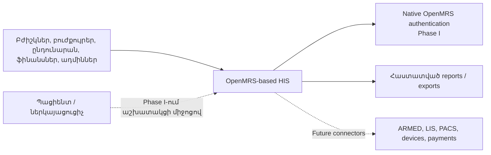
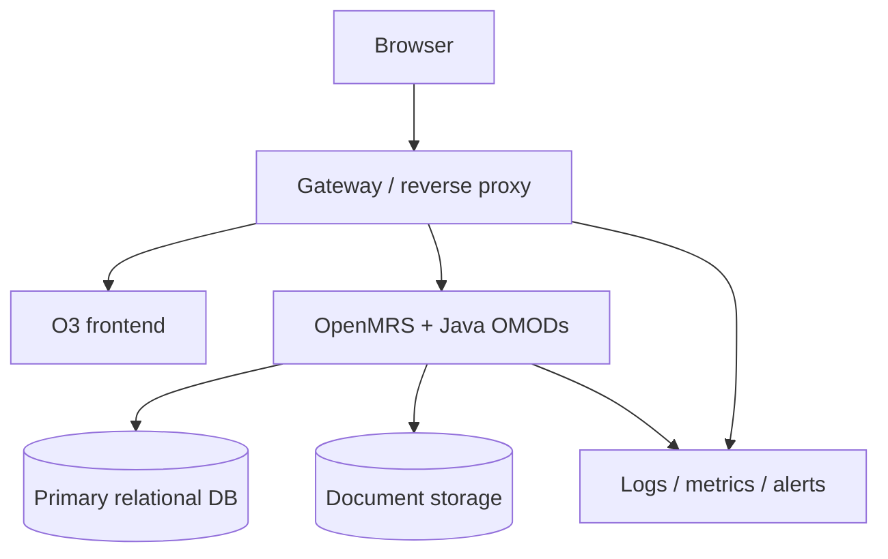

# System Architecture: Saribekyan HIS

## Purpose and status

Այս փաստաթուղթը սահմանում է Phase I-ի նպատակային ճարտարապետությունը, ոչ թե դեռ չգրված համակարգի as-built վիճակը։ Հաստատված հիմքերն են՝ **Size C**, **OpenMRS clinical foundation**, **Java backend extensions** և պայմանագրային Phase I scope-ը։ `Proposed` ու `PoC required` ընտրությունները վերջնական չեն մինչև համապատասխան ապացույցն ու ADR-ը։

## Architectural drivers

- մեկ canonical patient identity և longitudinal medical record,
- 150–200 աշխատակցի role/context-aware աշխատանք,
- clinical, financial և administrative auditability,
- հայերեն UI և վերահսկվող բժշկական ձևեր,
- մոդուլային ընդլայնում՝ առանց OpenMRS core fork-ի,
- վերահսկելի API-ներ, export և հետագա ինտեգրումներ։

## Architectural style

Ստորև նկարագրվածը **նպատակային architecture պատկերն է, ոչ business implementation սկսելու թույլտվություն**։ Մինչ D-008 pilot-ի ավարտը թույլատրված է միայն մեկ compatibility PoC՝ մեկ non-business pilot OMOD-ով և մեկ minimal O3 extension-ով՝ [implementation gate](./00-IMPLEMENTATION-GATE.md)-ի համաձայն։ REG–ADM business module-ները և ամբողջ distribution tree-ն մինչ այդ չեն ստեղծվում։

Pilot-ով հաստատվելու դեպքում նպատակային համակարգը OpenMRS distribution է՝ modular-monolith backend-ով (OpenMRS Platform, community OMOD-ներ և Java custom OMOD-ներ) և O3 microfrontend UI-ով։ Concepts, forms, locations, roles և distribution metadata-ն version-controlled configuration են։ Microservices-ը Phase I-ի default-ը չէ. առանձին service թույլատրվում է միայն չափված isolation/operational կարիքով և ADR-ով։

## System context

## System components

| Component | Responsibility | Status |
|---|---|---|
| Gateway/reverse proxy | TLS, routing, limits, security headers | Proposed; product TBD |
| O3 app shell | Navigation, localization, extensions, shared UI | Proposed |
| Reused O3 modules | Patient/chart/forms և fit-gap-ով հաստատված UI | PoC required |
| Custom O3 modules | Phase I-ի բացակայող workflows և Armenian UX | Target only; D-008-ը հիմա թույլ է տալիս միայն minimal non-business pilot extension |
| OpenMRS Platform | Patient, visit, encounter, obs, order, concepts | Approved foundation |
| Community/custom OMOD-ներ | Reused capability և Java business extensions | Target only; D-008-ը հիմա թույլ է տալիս միայն մեկ non-business pilot OMOD |
| Relational database | Canonical և module-owned transactional data | Engine/version TBD; MariaDB candidate |
| Document storage | Attachments և generated documents | Design/PoC required |
| Reporting/export | Contract reports, dashboards, controlled export | Mixed reused/custom |
| Identity boundary | Native OpenMRS authentication, lifecycle և role/privilege mapping | Phase I baseline; native MFA capability TBD |
| Audit capability | ADM-10 change, export և break-glass evidence; all-read audit-ը default չէ | Cross-cutting design |
| Operations layer | Logs, metrics, backup/restore, health, alerts | Detailed design pending |

## Functional boundaries

Phase I-ի boundaries-ն են Registration, Ambulatory, Inpatient, Diagnostics/Treatment, Finance, Reporting և Administration։ Boundary-ն ownership է, ոչ պարտադիր առանձին deployable service։

- Clinical canonical տվյալները փոփոխվում են OpenMRS service/API layer-ով։
- Custom աղյուսակ ստեղծվում է միայն երբ OpenMRS canonical model-ը բավարար չէ։
- Module-ը մյուս module-ի աղյուսակին ուղղակի չի գրում, այլ օգտագործում է public Java service/API contract։
- Frontend-ը database-ին ուղղակի չի միանում։
- Reporting store-ը չի դառնում երկրորդ clinical source of truth։

## Architectural invariants

1. Patient-ը ունի մեկ canonical OpenMRS identity և duplicate/merge ընթացակարգ։
2. Encounter/obs/order տվյալները չեն կրկնօրինակվում parallel custom clinical model-ում։
3. Authorization-ը server-side է. UI visibility-ն authorization չէ։
4. Access-ը կարող է սահմանափակվել role/privilege, location, department/service և care context-ով։ Սա մեկ բժշկական համալիր է, ոչ SaaS tenant model։
5. Medical/financial correction-ը traceable է. hard delete կամ լուռ overwrite-ը default չէ։
6. ADM-10 change audit-ը, export-ը և break-glass access-ը audit են արվում։ Ամեն patient record view-ի audit-ը առանձին չհաստատված որոշում է։
7. Integration-ը չի գրում DB-ին ուղղակի և չի շրջանցում business validation-ը։
8. OpenMRS/module/frontend exact versions-ը pin և compatibility-test են արվում։
9. OpenMRS core fork-ը պահանջում է առանձին ADR և upgrade-impact review։
10. External failure-ը չի թողնում local transaction-ը կիսատ կամ անորոշ։

## Core flows

- **Registration/encounter.** Duplicate search → canonical patient/visit → validated form → encounter/obs/order → audit։
- **Order/result.** Clinician order → internal status/result workflow → ապագա LIS/PACS adapter versioned contract-ով։
- **Finance.** Authorized charge/payment/refund/reversal → stable clinical reference → immutable correction trail։
- **Reporting/export.** Approved definition/filters → authorization → execution → requester/scope/result audit։

## Deployment baseline

Dev, test, UAT և production միջավայրերը տարանջատված են։ Phase I-ը պահանջում է production deployment, backup և փաստագրված restore verification, բայց ինքնաբերաբար չի խոստանում active-active, multi-region կամ zero-downtime SLA։ Hosting, topology, availability target և capacity-ն բաց որոշումներ են։

## Current scaling baseline

Հայտնի է մոտ 150–200 աշխատակից, բայց concurrency, encounters/day, document volume, report load և SLO-ները դեռ հաստատված չեն։ Սկզբնական baseline-ն է paginated/indexed queries, bounded uploads, controlled reports, health metrics և restore-tested backup։ Replica, queue, search cluster կամ service split ավելացվում է չափված bottleneck-ից հետո և ADR-ով։

## Consistency and failure rules

- Critical clinical/financial write-ը transactional boundary ունի։
- External network call-ը երկարատև ձևով չի պահվում DB transaction-ի ներսում։
- Retry ունեցող integration-ը պահանջում է idempotency և reconciliation։
- Uncertain outcome-ը ունի request/reference ID և support procedure։
- Backup-ը հաջող չէ, մինչև restore test-ը չի անցել։

## Decision rationale

| Decision | Why | Reference |
|---|---|---|
| OpenMRS foundation | Canonical clinical model-ը զրոյից չկառուցել | [ADR-0001](./architecture/ADR-0001-openmrs-foundation.md) |
| Extension over core fork | Պահպանել upgrade path-ը | [ADR-0002](./architecture/ADR-0002-extension-strategy.md) |
| Explicit identity boundary | Authentication-ը չշփոթել clinical authorization-ի հետ | [ADR-0003](./architecture/ADR-0003-identity-boundary.md) |

## Open questions

Exact distribution/module versions, DB engine/topology, native session/MFA configuration, document storage/scanning, background jobs, reporting isolation, audit retention, HA/SLA և RPO/RTO։ External IdP-ը Phase I-ի բաց ընտրություն չէ։ Յուրաքանչյուր նշանակալի պատասխան պահանջում է PoC evidence և անհրաժեշտության դեպքում ADR։
