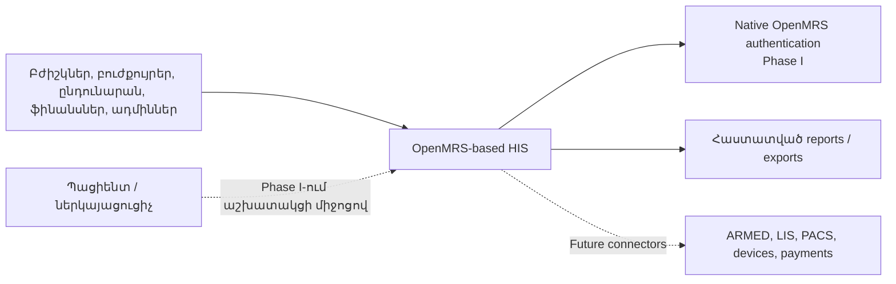
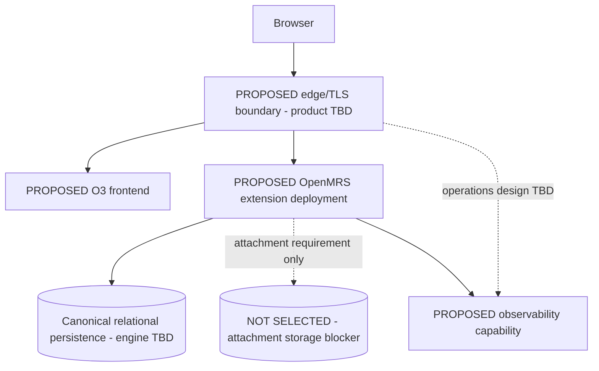

# System Architecture: Saribekyan HIS

## Purpose and status

Այս փաստաթուղթը սահմանում է Phase I-ի նպատակային ճարտարապետությունը, ոչ թե դեռ չգրված համակարգի as-built վիճակը։ Հաստատված ուղղություններն են՝ **Size C**, **OpenMRS clinical foundation** և **Java**-ն՝ որպես custom backend-ի լեզու։ OMOD/O3 փաթեթավորումը `Proposed` է [ADR-0002](./architecture/ADR-0002-extension-strategy.md)-ում և այս նախադասությամբ հաստատված չէ։ Owner-authorized Phase I scope-ը կիրառվում է առանց signature կամ TASK-GO prerequisite-ի։ `Proposed` ու `PoC required` տեխնիկական ընտրությունները վերջնական չեն մինչև համապատասխան ապացույցն ու ADR-ը, երբ տվյալ implementation-ը դրանցից կախված է։

Չնշված աղյուսակային status-ը կամ հրամայական architecture լեզուն նոր business scope չի ստեղծում։ Canonical foundation/no-fork/no-direct-SQL սահմանները governing են, իսկ component/topology/product/pattern ընտրությունները `PROPOSED_DESIGN` են մինչև կիրառելի Accepted decision։ TASK-GO record-ը optional review artifact է։

## Architectural drivers

- մեկ canonical patient identity և longitudinal medical record,
- 150–200 աշխատակցի role/context-aware աշխատանք,
- clinical, financial և administrative auditability,
- հայերեն UI և վերահսկվող բժշկական ձևեր,
- մոդուլային ընդլայնում՝ առանց OpenMRS core fork-ի,
- վերահսկելի API-ներ, export և հետագա ինտեգրումներ։

## Architectural style

Ստորև նկարագրվածը **նպատակային architecture պատկերն է, ոչ business implementation սկսելու թույլտվություն**։ D-008-ը թույլատրում է միայն մեկ compatibility PoC՝ մեկ non-business pilot OMOD-ով և մեկ minimal O3 extension-ով՝ [implementation gate](./00-IMPLEMENTATION-GATE.md)-ի համաձայն։ Pilot-ի տեխնիկական ավարտը go որոշում չէ։ REG–ADM business module-ները և production distribution tree-ն չեն ստեղծվում, մինչև evidence review/go որոշումը գրանցված չէ և ADR-0002-ը ընդունված կամ մերժված չէ։

Եթե pilot evidence-ի review/go որոշումը դրական է և ADR-0002-ն ընդունում է extension strategy-ն, նպատակային համակարգը կարող է հաստատվել որպես OpenMRS distribution՝ modular-monolith backend-ով (OpenMRS Platform, community OMOD-ներ և Java custom OMOD-ներ) և O3 microfrontend UI-ով։ Մինչ այդ OMOD/O3 business architecture-ը մնում է `Proposed`։ Եթե ADR-0002-ը մերժվի, այս repository-ում փոխարինող business architecture չկա։ Ագենտը չի ընտրում առանձին Spring/JPA մոդել, microservices կամ այլ փաթեթավորում. աշխատանքը կանգ է առնում մինչև նոր գրավոր որոշում։ Concepts, forms, locations, roles և distribution metadata-ն նպատակային տարբերակում version-controlled configuration են։ Microservices-ը Phase I-ի default-ը չէ. առանձին service թույլատրվում է միայն չափված isolation/operational կարիքով և ADR-ով։

## System context

## System components

| Component | Responsibility | Status |
|---|---|---|
| Gateway/reverse proxy | TLS, routing, limits, security headers | Proposed; product TBD |
| O3 app shell | Navigation, localization, extensions, shared UI | Proposed |
| Reused O3 modules | Patient/chart/forms և fit-gap-ով հաստատված UI | PoC required |
| Custom O3 modules | Phase I-ի բացակայող workflows և Armenian UX | PROPOSED_DESIGN; D-008-ը հիմա թույլ է տալիս միայն minimal non-business pilot extension |
| OpenMRS Platform | Patient, visit, encounter, obs, order, concepts | GOVERNING_CANONICAL_MODEL_NO_SKELETON; foundation ownership only, ոչ distribution/OMOD generation approval |
| Community/custom OMOD-ներ | Reused capability և Java business extensions | PROPOSED_DESIGN; D-008-ը հիմա թույլ է տալիս միայն մեկ non-business pilot OMOD |
| Relational database | Canonical և module-owned transactional data | Engine/version TBD; վերցվում է D-008 exact commit-ի supported manifest-ից և հաստատվում review/go-ով |
| Document storage | Attachments և generated documents | Design/PoC required |
| Reporting/export | Contract reports, dashboards, controlled export | PROPOSED_DESIGN; reuse/custom fit decision required |
| Identity boundary | Native OpenMRS authentication, lifecycle և role/privilege mapping | GOVERNING_GUARDRAIL_NO_GO; native MFA capability BLOCKED/TBD |
| Audit capability | ADM-10 change, export և break-glass evidence; all-read audit-ը default չէ | PROPOSED_DESIGN; cross-cutting ownership |
| Operations layer | Logs, metrics, backup/restore, health, alerts | Detailed design pending |

## Functional boundaries

Phase I-ի boundaries-ն են Registration, Ambulatory, Inpatient, Diagnostics/Treatment, Finance, Reporting և Administration։ Boundary-ն ownership է, ոչ պարտադիր առանձին deployable service։

- Clinical canonical տվյալները փոփոխվում են OpenMRS service/API layer-ով։
- Custom աղյուսակ ստեղծվում է միայն երբ OpenMRS canonical model-ը բավարար չէ։
- Module-ը մյուս module-ի աղյուսակին ուղղակի չի գրում, այլ օգտագործում է public Java service/API contract։
- Frontend-ը database-ին ուղղակի չի միանում։
- Reporting store-ը չի դառնում երկրորդ clinical source of truth։

## Architectural invariants

1. Patient identity-ի source of truth-ը canonical OpenMRS model-ն է։ Duplicate/merge algorithm, survivor rule, preview, irreversibility և audit behavior չեն սահմանվում այս invariant-ով և մնում են REG-03 `NO_GO`, մինչև approved policy-ն։
2. Encounter/obs/order տվյալները չեն կրկնօրինակվում parallel custom clinical model-ում։
3. Authorization-ը server-side է. UI visibility-ն authorization չէ։
4. Access-ը կարող է սահմանափակվել role/privilege, location, department/service և care context-ով։ Սա մեկ բժշկական համալիր է, ոչ SaaS tenant model։
5. Medical/financial correction-ը traceable է. hard delete կամ լուռ overwrite-ը default չէ։
6. ADM-10 change audit-ը, export-ը և break-glass access-ը audit են արվում։ Ամեն patient record view-ի audit-ը առանձին չհաստատված որոշում է։
7. Integration-ը չի գրում DB-ին ուղղակի և չի շրջանցում business validation-ը։
8. OpenMRS/module/frontend exact versions-ը pin և compatibility-test են արվում միայն հաջող D-008 evidence review/go որոշումից հետո։ Մինչ այդ agent-ը version չի pin անում։
9. Phase I-ում OpenMRS core fork կամ patch արգելված է։ Առանձին ADR-ը և upgrade-impact review-ը ներկայիս scope-ի ներսում բացառություն չեն ստեղծում։ Ապագա core փոփոխությունը կարող է քննարկվել միայն նոր գրավոր scope/change request-ի հաստատումից հետո՝ առանձին ADR-ով և upgrade-impact review-ով։ Մինչ այդ agent-ը կանգ է առնում և core-ը չի փոխում։
10. External failure-ը չի թողնում local transaction-ը կիսատ կամ անորոշ։

Invariant 9-ի `core patch`-ը նշանակում է OpenMRS core source code-ի փոփոխություն։ Այն չի արգելում D-008 spec-ով թույլատրված, ignored `pilot/openmrs-compatibility/work/reference-application/` պատճենի distro/assembly configuration patch-երը (`spa-assemble-config.patch`, `omod-inclusion.patch`)։

## Core flows

- **Registration/encounter.** Duplicate search → canonical patient/visit → validated form → encounter/obs/order → audit։
- **Order/result.** Clinician order → approved internal order/result workflows։ LIS/PACS-ը միայն future external boundary է. այս flow-ը adapter, port, interface, versioned contract կամ connector ստեղծելու հանձնարարական չէ։
- **Finance.** Authorized charge/payment/refund/reversal → stable clinical reference → immutable correction trail։
- **Reporting/export.** Approved definition/filters → authorization → execution → requester/scope/result audit։

## Deployment baseline

Diagram-ի յուրաքանչյուր node capability/context է, ոչ deployable service, repository artifact կամ dependency prescription։ Մասնավորապես Edge/Gateway, document storage և observability product/service չեն ստեղծվում այս գծապատկերից. attachment storage-ը բաց blocker է։

Dev/test/UAT/production-ը lifecycle և access-isolation context-ներ են, ոչ այս փաստաթղթով պարտադրված չորս առանձին վճարովի deployment։ Պայմանագրային minimum-ը ժամանակավոր test միջավայրն ու մեկ production deployment-ն է՝ signed contract-ի համաձայն։ Առանձին provisioned environment-ների քանակը, topology-ն, payer-ը և promotion model-ը բաց infrastructure որոշումներ են։ Phase I-ը պահանջում է production deployment, backup և փաստագրված restore verification, բայց ինքնաբերաբար չի խոստանում active-active, multi-region կամ zero-downtime SLA։

## Current scaling baseline

Հայտնի է մոտ 150–200 աշխատակից, բայց concurrency, encounters/day, document volume, report load և SLO-ները դեռ հաստատված չեն։ Սկզբնական baseline-ն է paginated/indexed queries, bounded uploads, controlled reports, health metrics և restore-tested backup։ Replica, queue, search cluster կամ service split ավելացվում է չափված bottleneck-ից հետո և ADR-ով։

## Consistency and failure rules

- Critical clinical/financial write-ը transactional boundary ունի։
- External network call-ը երկարատև ձևով չի պահվում DB transaction-ի ներսում։
- Retry ունեցող integration-ը պահանջում է idempotency և reconciliation։
- Uncertain outcome-ը ունի request/reference ID և support procedure։
- Backup-ը հաջող չէ, մինչև restore test-ը չի անցել։

## Decision rationale

| Decision | Why | Reference |
|---|---|---|
| OpenMRS foundation | Canonical clinical model-ը զրոյից չկառուցել | [ADR-0001](./architecture/ADR-0001-openmrs-foundation.md) |
| Extension over core fork | Պահպանել upgrade path-ը | [ADR-0002](./architecture/ADR-0002-extension-strategy.md) |
| Explicit identity boundary | Authentication-ը չշփոթել clinical authorization-ի հետ | [ADR-0003](./architecture/ADR-0003-identity-boundary.md) |

## Open questions

Exact distribution/module versions, DB engine/topology, native session/MFA configuration, document storage/scanning, background jobs, reporting isolation, audit retention, HA/SLA և RPO/RTO։ External IdP-ը Phase I-ի բաց ընտրություն չէ։ Յուրաքանչյուր նշանակալի պատասխան պահանջում է PoC evidence և անհրաժեշտության դեպքում ADR։
