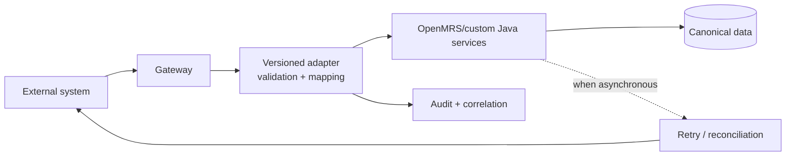

# Integrations Architecture

> **Կարգավիճակ:** target integration design և future connector checklist է, ոչ coding authorization։ Phase I-ում կառուցվում են միայն ստորագրված ՏԱ-ի traceable interface/report/export ID-ները։ «API/integration foundation» արտահայտությունը չի թույլատրում ընդհանուր `/api/v1` facade, connector, queue կամ adapter ստեղծել առանց հաստատված use case-ի։ D-008 compatibility PoC-ի probe-ը կարգավորվում է միայն PoC spec-ով և այս architecture-ի implementation-ը չէ։

> **Rule classification:** Phase I connector exclusions-ը governing scope boundary են։ Adapter/retry/idempotency/gateway/FHIR և operational checklist կետերը `PROPOSED_DESIGN` են մինչև կոնկրետ connector change request-ը և task go record-ը հաստատված չեն։

## Phase I boundary

Phase I-ի նպատակային սահմանում կա integration-ready architecture և ստորագրված պայմանագրով ID-ավորված reports/file exports։ Սա ինքնուրույն deliverable կամ coding task չէ։ ARMED, LIS, PACS/DICOM, devices, accounting, POS/payment, SMS/email և qualified e-signature connector-ները դուրս են Phase I-ից առանց հաստատված change request-ի։

## Interface layers

| Layer | Purpose |
|---|---|
| OpenMRS Java service API | Server-side module collaboration |
| OpenMRS REST | O3/internal web use cases, երբ semantic fit կա |
| FHIR R4/FHIR2 | Հաստատված interoperability resources/use cases |
| Custom versioned facade | Custom workflows, որոնք REST/FHIR-ը ճիշտ չեն ներկայացնում |
| Controlled files | Contract reports, finance exports և approved initial import |

FHIR endpoint-ի առկայությունը դեռ չի ապացուցում workflow interoperability. mapping, terminology, lifecycle և profile-ը հաստատվում են use case առ use case։

## Principles

1. External system-ը DB-ին ուղղակի չի միանում։
2. Յուրաքանչյուր interface ունի owner, version և data contract։
3. Machine identity-ն least-privilege է, credential rotation/revocation-ով։
4. Inbound request-ն ունի authentication, validation, replay/idempotency և audit controls։
5. Outbound delivery-ն ունի timeout, retry, terminal failure և reconciliation։
6. Correlation ID-ն կապում է փորձերը՝ առանց secrets/clinical payload log անելու։
7. External failure-ը չի ստեղծում կիսատ clinical/financial state։
8. Breaking change-ը պահանջում է նոր version և consumer migration window։

## Required integration record

Յուրաքանչյուր connector-ի համար պարտադիր են business/technical owners, direction/trigger, minimum dataset/purpose, identifier mapping, contract/version, authentication, authorization scope, idempotency, timeout/retry, reconciliation, audit/privacy, sandbox/certification, availability և recurring costs։

## Candidate register

| Candidate | Phase I state | Required future proof |
|---|---|---|
| ARMED | Connector out of scope | Contract/accesses/mapping/certification |
| LIS | Out of scope | Order/result IDs, corrections, reconciliation |
| PACS/DICOM | Out of scope | Order/study/report mapping; images outside HIS DB |
| Devices | Out of scope | Device identity, units, context, human verification |
| Accounting | Only approved exports | Immutable references and reconciliation |
| Payments | Out of scope | Idempotent payment/refund callbacks |
| SMS/email | Out of scope | Consent, templates, delivery state, PHI minimization |
| Qualified e-signature | Out of scope | Trust/certificate/evidence retention |
| WHO ICD API | Չհաստատված future candidate | Phase I version/content-ը տալիս կամ հաստատում է Պատվիրատուն. API sync չի կառուցվում ինքնուրույն |

## Data migration and API governance

Approved initial import-ը պահանջում է source inventory, mapping, dry run, rejects, reconciliation totals, approval և rerun/rollback procedure։ Այն չի շրջանցում canonical IDs կամ provenance-ը։

API-ն versioned և machine-readable է որտեղ կիրառելի է, external surface-ը չի բացում բոլոր internal endpoints-ը, error-ը ունի stable code/correlation ID, իսկ pagination/filtering/sorting-ը shared convention է։ Secrets-ը query string-ում կամ log-ում չեն հայտնվում։

Connector ակտիվացնելուց առաջ պարտադիր են approved use case, data-owner/privacy review, test environment, mapping/idempotency/failure tests, monitoring, operational owner, rollback switch և թարմացված documentation։ Background delivery mechanism-ը, gateway-ը, FHIR profiles-ը, retention-ը և connector SLA-ները դեռ բաց որոշումներ են։
